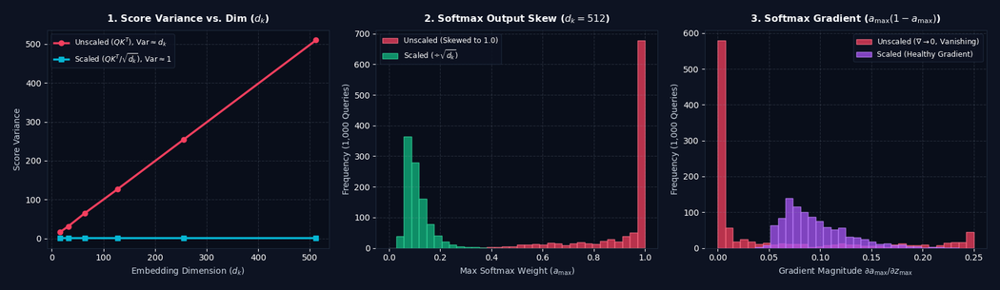

# Why Do We Normalize Attention by $\sqrt{d_k}$?

In Transformer architectures, the core **Scaled Dot-Product Attention** mechanism computes the alignment between Query ($Q$) and Key ($K$) matrices to weight the Value ($V$) representations:

$$\text{Attention}(Q, K, V) = \text{softmax}\left(\frac{QK^T}{\sqrt{d_k}}\right)V \tag{1}$$

A critical question arises when inspecting Equation (1): **Why do we divide the raw dot-product similarity $QK^T$ by $\sqrt{d_k}$, the square root of the embedding dimension?**

In short, normalizing by $\sqrt{d_k}$ **fixes the variance** of the attention scores back to $1$, which prevents the **softmax output from skewing** into a saturated one-hot distribution where gradients vanish.

---

## 1. The Variance Growth Problem in Dot Products

Assume that the components of a query vector $q \in \mathbb{R}^{d_k}$ and a key vector $k \in \mathbb{R}^{d_k}$ are independent random variables initialized with zero mean ($\mu = 0$) and unit variance ($\sigma^2 = 1$).

The unscaled attention score between a single query and key is their dot product:

$$s = q \cdot k = \sum_{i=1}^{d_k} q_i k_i$$

Let's examine the mean and variance of each individual product term $q_i k_i$:
* **Mean:** Since $q_i$ and $k_i$ are independent, $\mathbb{E}[q_i k_i] = \mathbb{E}[q_i]\mathbb{E}[k_i] = 0 \cdot 0 = 0$.
* **Variance:** Using the variance of the product of independent variables, $\text{Var}(q_i k_i) = \mathbb{E}[q_i^2]\mathbb{E}[k_i^2] - (\mathbb{E}[q_i k_i])^2 = 1 \cdot 1 - 0 = 1$.

Because the dot product sums $d_k$ independent terms, the variance of the unscaled attention score grows **linearly** with the embedding dimension $d_k$:

$$\text{Var}(q \cdot k) = \sum_{i=1}^{d_k} \text{Var}(q_i k_i) = d_k \quad \implies \quad \sigma = \sqrt{d_k}$$

For a high-dimensional embedding such as $d_k = 512$, the variance of the unscaled scores jumps to $512$ (a standard deviation of $\sqrt{512} \approx 22.63$), producing extreme positive and negative logits.

---

## 2. How High Variance Skews the Softmax Output

The attention scores are passed directly into the $\text{softmax}$ function to produce a probability distribution over keys:

$$\text{softmax}(z_i) = \frac{e^{z_i}}{\sum_{j=1}^{N} e^{z_j}}$$

Because $\text{softmax}$ exponentiates every input logit, large variance in $z$ has a severe compounding effect:
1. **Probability Skew (One-Hot Saturation):** When logits have a wide spread ($\sigma = \sqrt{d_k}$), the largest score dominates the exponential sum. Consequently, the maximum token receives a probability close to $1.0$, while all other tokens collapse to $0.0$.
2. **Vanishing Gradients:** The Jacobian of the softmax function is $\frac{\partial a_i}{\partial z_j} = a_i (\delta_{ij} - a_j)$, where $a_i = \text{softmax}(z_i)$. When the softmax output skews so that one weight $a_{\max} \approx 1$ and all others $a_j \approx 0$, every term $a_i(1 - a_i) \approx 0$ and $-a_i a_j \approx 0$. Gradients vanish, and training stalls.

---

## 3. Fixing Variance with $\frac{1}{\sqrt{d_k}}$

To prevent the variance from scaling with $d_k$, we divide the dot product by $\sqrt{d_k}$. By the quadratic scaling property of variance, $\text{Var}(c X) = c^2 \text{Var}(X)$:

$$\text{Var}\left(\frac{q \cdot k}{\sqrt{d_k}}\right) = \left(\frac{1}{\sqrt{d_k}}\right)^2 \text{Var}(q \cdot k) = \frac{1}{d_k} \cdot d_k = 1$$

> **💡 Key Takeaway:** Dividing by $\sqrt{d_k}$ locks the attention score variance strictly to **$\sigma^2 = 1$** regardless of how large the embedding dimension $d_k$ grows, ensuring well-distributed softmax probabilities and healthy gradient flow.

---

## Summary Comparison

| Property | Unscaled Attention ($QK^T$) | Scaled Attention ($\frac{QK^T}{\sqrt{d_k}}$) |
| :--- | :--- | :--- |
| **Score Mean ($\mu$)** | $0$ | $0$ |
| **Score Variance ($\sigma^2$)** | **$d_k$** (grows linearly with dimension) | **$1$** (constant across all dimensions) |
| **Softmax Distribution** | **Skewed / Peaked** (saturates toward $0$ and $1$) | **Balanced / Smooth** (spread across relevant tokens) |
| **Gradient Flow** | Vanishing gradients ($\frac{\partial \text{softmax}}{\partial z} \to 0$) | Stable, non-zero gradients during backpropagation |

---

## 💻 Python Verification & Visualization

The script below empirically verifies all three phenomena across three subplots:
1. **Left Graph (Variance Growth):** Plots the variance of unscaled ($QK^T$) vs. scaled ($\frac{QK^T}{\sqrt{d_k}}$) attention scores across increasing embedding dimensions $d_k \in [16, 32, 64, 128, 256, 512]$.
2. **Middle Graph (Softmax Output Skew):** Plots the histogram of the maximum softmax probability ($a_{\max}$) per query at $d_k = 512$, illustrating how unscaled scores skew the softmax output toward $1.0$.
3. **Right Graph (Vanishing Gradient):** Plots the histogram of the softmax gradient $\frac{\partial a_{\max}}{\partial z_{\max}} = a_{\max}(1 - a_{\max})$, showing how unscaled softmax gradients collapse to $0.0$ while scaled attention preserves a healthy gradient distribution.

```python
import numpy as np
import matplotlib.pyplot as plt

# Set random seed for reproducibility
np.random.seed(42)

# 1. Measure Variance across Embedding Dimensions (d_k)
dims = [16, 32, 64, 128, 256, 512]
num_queries, num_keys = 256, 256
unscaled_vars = []
scaled_vars = []

for d_k in dims:
    Q = np.random.randn(num_queries, d_k)  # Mean = 0, Variance = 1
    K = np.random.randn(num_keys, d_k)     # Mean = 0, Variance = 1
    
    unscaled_scores = Q @ K.T
    scaled_scores = unscaled_scores / np.sqrt(d_k)
    
    unscaled_vars.append(np.var(unscaled_scores))
    scaled_vars.append(np.var(scaled_scores))

# 2. Compute Softmax Distribution for a large embedding dimension (d_k = 512)
d_k = 512
seq_len = 64
Q = np.random.randn(1000, d_k)
K = np.random.randn(seq_len, d_k)

def softmax(x):
    e_x = np.exp(x - np.max(x, axis=-1, keepdims=True))
    return e_x / np.sum(e_x, axis=-1, keepdims=True)

unscaled_scores = Q @ K.T
scaled_scores = unscaled_scores / np.sqrt(d_k)

unscaled_softmax = softmax(unscaled_scores)
scaled_softmax = softmax(scaled_scores)

# 3. Compute Softmax Local Gradient: d(a_max)/d(z_max) = a_max * (1 - a_max)
unscaled_max_prob = unscaled_softmax.max(axis=-1)
scaled_max_prob = scaled_softmax.max(axis=-1)

unscaled_grad = unscaled_max_prob * (1.0 - unscaled_max_prob)
scaled_grad = scaled_max_prob * (1.0 - scaled_max_prob)

# Plot Variance Growth, Softmax Skew, and Vanishing Gradients
fig, axes = plt.subplots(1, 3, figsize=(16.5, 4.8))

# Subplot 1: Variance of Unscaled vs. Scaled Scores
axes[0].plot(dims, unscaled_vars, marker='o', linewidth=2.5, label=r'Unscaled ($QK^T$), $\mathrm{Var} \approx d_k$')
axes[0].plot(dims, scaled_vars, marker='s', linewidth=2.5, label=r'Scaled ($QK^T / \sqrt{d_k}$), $\mathrm{Var} \approx 1$')
axes[0].set_title('1. Score Variance vs. Dim ($d_k$)')
axes[0].set_xlabel('Embedding Dimension ($d_k$)')
axes[0].set_ylabel('Score Variance')
axes[0].grid(True, linestyle='--', alpha=0.3)
axes[0].legend()

# Subplot 2: Histogram of Softmax Outputs
bins_prob = np.linspace(0, 1, 35)
axes[1].hist(unscaled_max_prob, bins=bins_prob, alpha=0.75, label='Unscaled (Skewed to 1.0)')
axes[1].hist(scaled_max_prob, bins=bins_prob, alpha=0.75, label=r'Scaled ($\div \sqrt{d_k}$)')
axes[1].set_title(f'2. Softmax Output Skew ($d_k = {d_k}$)')
axes[1].set_xlabel(r'Max Softmax Weight ($a_{\max}$)')
axes[1].set_ylabel('Frequency (1,000 Queries)')
axes[1].grid(True, linestyle='--', alpha=0.3)
axes[1].legend()

# Subplot 3: Histogram of Softmax Gradients (Vanishing Gradient)
bins_grad = np.linspace(0, 0.25, 35)
axes[2].hist(unscaled_grad, bins=bins_grad, alpha=0.75, label=r'Unscaled ($\nabla \to 0$, Vanishing)')
axes[2].hist(scaled_grad, bins=bins_grad, alpha=0.75, label='Scaled (Healthy Gradient)')
axes[2].set_title(r'3. Softmax Gradient ($a_{\max}(1 - a_{\max})$)')
axes[2].set_xlabel(r'Gradient Magnitude $\partial a_{\max} / \partial z_{\max}$')
axes[2].set_ylabel('Frequency (1,000 Queries)')
axes[2].grid(True, linestyle='--', alpha=0.3)
axes[2].legend()

plt.tight_layout()
plt.show()
```


